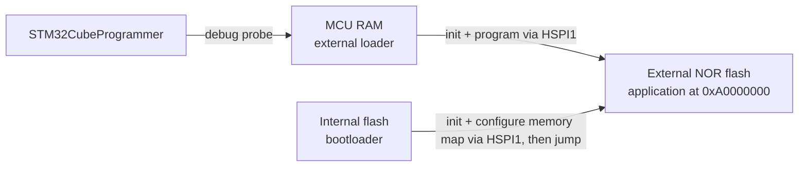

# external_loader

External NOR flash work for an STM32U5G9ZJ board (IS25LP128F on HSPI1).

Current focus: flash driver + on-target test app.

## Hardware

| Item | Value |
|---|---|
| MCU | STM32U5G9ZJ |
| External flash | ISSI IS25LP128F, 128 Mbit (16 MB) NOR, quad SPI |
| Interface | HSPI1, 4 data lines |
| Pins | PH9 NCS, PH10–PH13 IO0–IO3, PI3 CLK |
| Memory-mapped address | `0xA0000000` |
| Crystal | 24 MHz HSE (assumption) |

## System concept

The application does not run from the MCU's internal flash. It is stored in the external NOR flash and executed from there. Three pieces of software make this work:

1. **Bootloader** – lives in the internal flash. After reset it initialises the external flash, switches HSPI1 to memory-mapped mode so the flash appears at `0xA0000000`, and jumps to the application.
2. **External loader** (this repository) – a small program that STM32CubeProgrammer loads into the MCU's RAM through the debug probe. It provides the routines the programmer calls to initialise, erase, write and verify the external flash, and is built as a `.stldr` file.
3. **Application** – linked to run at the external flash address and programmed there using the external loader.



## Source layout

```
flash/         IS25LP128F driver
test/          On-target flash driver test app (HSPI bring-up + cases)
third_party/   STM32U5 HAL + CMSIS (git submodules)
doc/           System concept and driver design
```

After clone:

```bash
git submodule update --init --recursive
```

## Build (Docker)

ARM GCC lives in the container; the repo is bind-mounted at `/work`.

```bash
make docker-build          # build test/ → test/build/flash_test.elf
make docker-shell          # interactive shell in the container
make docker-clean          # remove test/build
```

Or with Compose directly:

```bash
docker compose build
docker compose run --rm build          # one-shot make -C test
docker compose run --rm shell          # bash
```

## IDE in the container (Cursor / VS Code)

Cursor stays on the host and attaches into the container (Dev Containers). The terminal and toolchain then run inside Docker.

1. Install the **Dev Containers** extension (Anysphere / Cursor).
2. Open this repo in Cursor.
3. Command Palette (`Cmd+Shift+P`) → **Dev Containers: Reopen in Container**.
4. Wait for the image build; the status bar shows you are in the container.
5. In the integrated terminal: `make -C test`.

Config: [`.devcontainer/devcontainer.json`](.devcontainer/devcontainer.json) (uses the same `Dockerfile`).

To leave: **Dev Containers: Reopen Folder Locally**.  
To refresh after Dockerfile changes: **Dev Containers: Rebuild Container**.

Alternative without Dev Containers: keep Cursor local and only use `make docker-build` / `make docker-shell` for compiles.

Details: [doc/system_concept.md](doc/system_concept.md), [doc/flash_driver_design.md](doc/flash_driver_design.md), [doc/flash_test_coverage.md](doc/flash_test_coverage.md).

## References

- [STM32U5G9ZJ datasheet](https://www.st.com/resource/en/datasheet/stm32u5g9zj.pdf) (STMicroelectronics, DS14102 Rev 5)
- [IS25LP128F datasheet](https://www.issi.com/WW/pdf/25LP-WP128F.pdf) (ISSI, Rev. A10, 03/09/2026)

- https://github.com/STMicroelectronics/stm32-memory-loaders/tree/contrib
- https://github.com/STMicroelectronics/stm32u5x9j-dk-bsp

- https://github.com/STMicroelectronics/stm32u5xx-hal-driver
- https://github.com/STMicroelectronics/cmsis_device_u5
