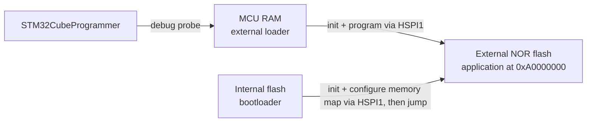

# external_loader

External NOR flash work for an STM32U5G9ZJ board (IS25LP128F on HSPI1).

Current focus: flash driver + on-target test app.

## Hardware

| Item | Value |
|---|---|
| MCU | STM32U5G9ZJ |
| External flash | ISSI IS25LP128F, 128 Mbit (16 MB) NOR, quad SPI |
| Interface | HSPI1, 4 data lines |
| Pins | PH9 NCS, PH10–PH13 IO0–IO3, PI3 CLK |
| Memory-mapped address | `0xA0000000` |
| Crystal | 24 MHz HSE (assumption) |

## System concept

The application does not run from the MCU's internal flash. It is stored in the external NOR flash and executed from there. Three pieces of software make this work:

1. **Bootloader** – lives in the internal flash. After reset it initialises the external flash, switches HSPI1 to memory-mapped mode so the flash appears at `0xA0000000`, and jumps to the application.
2. **External loader** (this repository) – a small program that STM32CubeProgrammer loads into the MCU's RAM through the debug probe. It provides the routines the programmer calls to initialise, erase, write and verify the external flash, and is built as a `.stldr` file.
3. **Application** – linked to run at the external flash address and programmed there using the external loader.



## Source layout

```
flash/         IS25LP128F driver
loader/        External loader (.stldr) sources — StorageInfo, entry points
flash_test/    On-target flash driver test app (HSPI bring-up + cases)
third_party/   STM32U5 HAL + CMSIS (git submodules)
doc/           System concept, driver design, design decisions, gaps
```

- Design decisions: [`doc/design_decisions.md`](doc/design_decisions.md)
- Known gaps and next steps: [`doc/known_gaps_and_next_steps.md`](doc/known_gaps_and_next_steps.md)

After clone:

```bash
git submodule update --init --recursive
```

## Build

ARM GCC and CMake live in the container; the repo is bind-mounted at `/work`.
Run make from the **repo root** (not from `flash_test/` or `loader/`).

Inside the container:

```bash
make                 # both targets
make flash_test      # → flash_test/build/flash_test.elf
make loader          # → loader/build/IS25LP128F_STM32U5G9ZJ.stldr
make clean
make clean-flash_test
make clean-loader
```

Copy the `.stldr` into STM32CubeProgrammer’s `bin/ExternalLoader` directory to use it.

## References

- [STM32U5G9ZJ datasheet](https://www.st.com/resource/en/datasheet/stm32u5g9zj.pdf) (STMicroelectronics, DS14102 Rev 5)
- [IS25LP128F datasheet](https://www.issi.com/WW/pdf/25LP-WP128F.pdf) (ISSI, Rev. A10, 03/09/2026)

- https://github.com/STMicroelectronics/stm32-memory-loaders/tree/contrib
- https://github.com/STMicroelectronics/stm32u5x9j-dk-bsp

- https://github.com/STMicroelectronics/stm32u5xx-hal-driver
- https://github.com/STMicroelectronics/cmsis_device_u5
