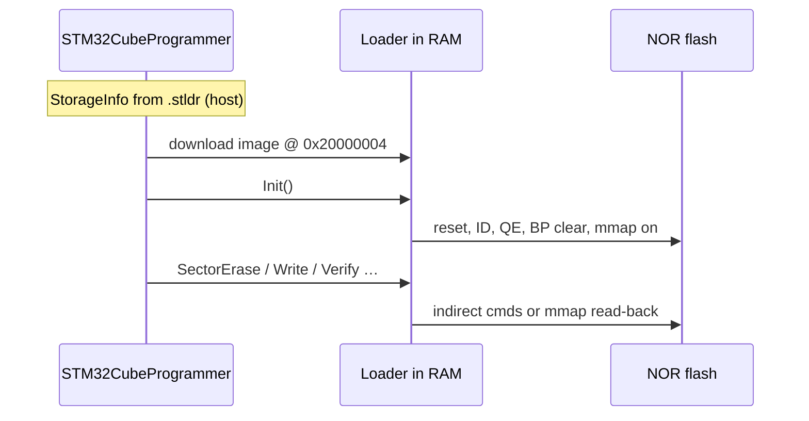
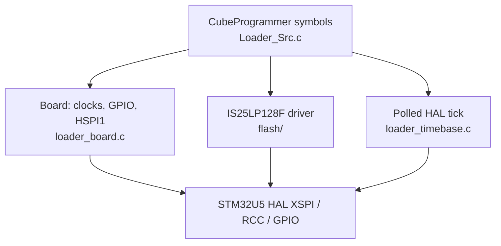

# External loader design

Design of the STM32CubeProgrammer external loader (`.stldr`) for the IS25LP128F on STM32U5G9ZJ / HSPI1. System roles and programming sequence: [`technical_concept.md`](technical_concept.md). Flash command set and driver API: [`flash_driver_design.md`](flash_driver_design.md).

## 1. Purpose and non-goals

| In scope | Out of scope |
|---|---|
| Erase / program / verify external NOR via CubeProgrammer | Product bootloader or XIP application |
| RAM-resident image called through the debug probe | Interrupts, RTOS, or a normal `main` |
| Board bring-up for programming (clocks, GPIO, HSPI1) | Fastest possible HSPI clock (24 MHz is intentional) |
| Shared `flash/` driver for IS25 commands | SEGGER native loader format (different wrapper later) |

The loader and the bootloader never run at the same time. They share the flash driver; board bring-up is duplicated per image.

## 2. Source layout

```
loader/
  Inc/
    Dev_Inf.h          StorageInfo layout (host-readable)
    Loader_Src.h       CubeProgrammer entry points + return codes
    loader_board.h     Clock / GPIO / HSPI1 bring-up
    stm32u5xx_hal_conf.h
  Src/
    Dev_Inf.c          StorageInfo instance (.Dev_info)
    Loader_Src.c       Init, Write, erase, Read, Verify, CheckSum
    loader_board.c     HSE → SYSCLK, HSPI1 + pin mux
    loader_timebase.c  Polled HAL tick (no SysTick IRQ)
  STM32U5G9ZJTx_RAM.ld
  CMakeLists.txt       → IS25LP128F_STM32U5G9ZJ.stldr
```

Shared: `flash/` (IS25 driver), `third_party/` (STM32U5 HAL + CMSIS). No startup `.s` file; link with `-nostartfiles`.

## 3. How CubeProgrammer runs the loader

The `.stldr` is a renamed ELF. CubeProgrammer does **not** boot the MCU into it.

1. Reads `StorageInfo` from the file on the **PC** (geometry, base `0xA0000000`).
2. Halts the core over SWD and downloads the Loader segment into SRAM1 at `0x20000004`.
3. Leaves a tiny stub at `0x20000000` (typically `BKPT`) as the return address (`LR`).
4. Sets stack and arguments (AAPCS), sets `PC` to a exported symbol (`Init`, `Write`, …), resumes.
5. On return the stub traps; the tool reads the return value and continues.



Consequences:

- **No reset handler / `main` / vector table** for this session → interrupts stay off.
- **`Init` is the real entry** (`ENTRY(Init)`): clear `.bss`, `SystemInit`, `HAL_Init`, board + flash init.
- **`Init` must be repeatable** after bootloader or application use (HSPI forced reset in board init).

## 4. Memory and link layout

| Region | Address | Role |
|---|---|---|
| Probe stub | `0x20000000` | CubeProgrammer `BKPT` return stub (not part of our image) |
| Loader image | `0x20000004` … ~`0x2003FFFF` | Code, rodata, data, bss, small heap/stack (~256 KB − 4) |
| Programmer buffer | Rest of SRAM1 (up to `0x200BFFFF`) | Write payload; loader must not claim all of SRAM1 |
| External flash (mmap) | `0xA0000000` … `0xA0FFFFFF` | 16 MB NOR when HSPI1 is memory-mapped |

Linker script `STM32U5G9ZJTx_RAM.ld`:

- `MEMORY`: `RAM` at `ORIGIN = 0x20000004`, `LENGTH = 256K - 4`
- Two ELF segments: **Loader** (`PT_LOAD` for download) and **SgInfo** (`.Dev_info` for the host)
- VMA == LMA for `.text` / `.data` (image is written straight into RAM)
- Symbols kept despite `--gc-sections`: `Init`, `Write`, `SectorErase`, `MassErase`, `Read`, `Verify`, `CheckSum`

The `+4` offset is an ST tooling convention for U5 loaders (H7 uses `0x24000004` the same way), not an MCU limit.

## 5. StorageInfo

Defined in `Dev_Inf.c`, section `.Dev_info`. CubeProgrammer reads it from the file, not from the target.

| Field | Value |
|---|---|
| Device name | `IS25LP128F_STM32U5G9ZJ` |
| Type | `NOR_FLASH` |
| Start | `0xA0000000` |
| Size | `0x01000000` (16 MB) |
| Page size | `0x100` |
| Erased value | `0xFF` |
| Sectors | 4096 × `0x1000` |

Must stay aligned with `flash/Inc/is25lp128f.h` geometry.

## 6. Entry points

Return convention for most calls: **`1` = success (`LOADER_OK`), `0` = failure (`LOADER_FAIL`)**. `Verify` / `CheckSum` follow ST’s checksum conventions.

Addresses from the programmer are **absolute** (`0xA0…`). Helpers subtract `EXT_FLASH_BASE` before calling the flash driver (which uses flash-relative offsets).

| Symbol | Role |
|---|---|
| `Init` | Zero `.bss`, `SystemInit`, `HAL_Init`, `Loader_BoardInit`, `IS25_Init`, leave **memory-mapped** |
| `Write` | Program `Size` bytes from RAM buffer; driver leaves mmap |
| `SectorErase` | Erase every 4 KB sector from start…end (inclusive range, start aligned down) |
| `MassErase` | Full chip erase (`IS25_EraseChip`, clears BP first) |
| `Read` | Optional; enable mmap, `memcpy` from `0xA0000000 + offset` |
| `Verify` | Optional; mmap compare vs RAM buffer; returns ST-style checksum encoding |
| `CheckSum` | Optional; byte sum over mmap window (ST algorithm, misalignment handling) |

### `Init` sequence

1. `Loader_ZeroBss`
2. `SystemInit`
3. `HAL_Init` (installs polled tick via `HAL_InitTick` override)
4. `Loader_BoardInit` → HSE 24 MHz SYSCLK, HSPI1 + pins
5. `IS25_Init` → software reset, JEDEC check, QE, clear BP (indirect mode)
6. `IS25_EnableMemoryMapped` → programmer can read the `0xA0000000` window

### Mode switching

| After | HSPI mode |
|---|---|
| `Init` / `Read` / `Verify` | Memory-mapped (`EBh`) |
| `Write` / erase paths | Indirect (driver `EnsureReady` disables mmap) |

## 7. Board bring-up

`loader_board.c`:

| Item | Choice |
|---|---|
| SYSCLK | 24 MHz HSE, no PLL |
| Flash latency | `FLASH_LATENCY_0` |
| HSPI kernel clock | `RCC_HSPICLKSOURCE_SYSCLK` |
| HSPI prescaler | 0 → 24 MHz SCLK |
| Pins | PH9 NCS, PH10–PH13 IO0–IO3, PI3 CLK, AF8 |
| Re-entry | `__HAL_RCC_HSPI1_FORCE_RESET` before `HAL_XSPI_Init` |

Programming time is dominated by NOR erase/program; a simple clock tree is preferred over speed. Bootloader may later use a higher HSPI clock (see technical concept clock table).

## 8. Polled time base

No usable vector table → SysTick IRQ must not run.

`loader_timebase.c` overrides:

- `HAL_InitTick` — SysTick free-running 24-bit down-counter, **`TICKINT` clear**
- `HAL_GetTick` — sample counter, advance `uwTick` in software
- `HAL_SuspendTick` / `HAL_ResumeTick` — enable bit only; never set `TICKINT`

Needed so HAL/XSPI timeouts and WIP polling (including long chip erase) work without interrupts. Detail: [technical concept § polled time base](technical_concept.md#polled-time-base).

## 9. Layering



| In `loader/` | Outside |
|---|---|
| `.stldr` entry points, `StorageInfo`, RAM link | `flash/`: IS25 commands, page split, mmap `EBh` config |
| Clock / pin / HSPI instance init | `flash_test/`: on-target driver suite (not the `.stldr` path) |
| Polled tick | Bootloader (future): own board bring-up + jump to app |

## 10. Design decisions

| Decision | Choice | Why |
|---|---|---|
| No startup / crt0 | `-nostartfiles`, `ENTRY(Init)` | Matches CubeProgrammer call model |
| Image at `0x20000004` | Leave `0x20000000` free | ST U5 loader convention for return stub |
| Claim ~256 KB RAM only | Rest for programmer buffer | Avoid collisions with write payloads |
| Return `1` / `0` | ST loader convention | CubeProgrammer expects this, not POSIX errno |
| Absolute addresses in API | Subtract base in loader | Programmer speaks mmap addresses; driver stays offset-based |
| `Init` ends in mmap | Enable after `IS25_Init` | Host can read external flash window directly |
| HSPI reset in board init | Force/release before init | Safe re-entry after bootloader/app |
| Interrupts off | Polled SysTick | No vector table; avoid HardFault on tick |
| Program via `02h` | Through shared driver | Robust bring-up; quad program optional later |
| Build artifact | Copy ELF → `.stldr` | CubeProgrammer external loader directory |

## 11. Build and use

From repo root (container):

```bash
make loader   # → loader/build/IS25LP128F_STM32U5G9ZJ.stldr
```

Copy the `.stldr` into STM32CubeProgrammer `bin/ExternalLoader`. Select the loader, program the application image linked for `0xA0000000`.

