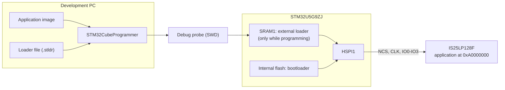
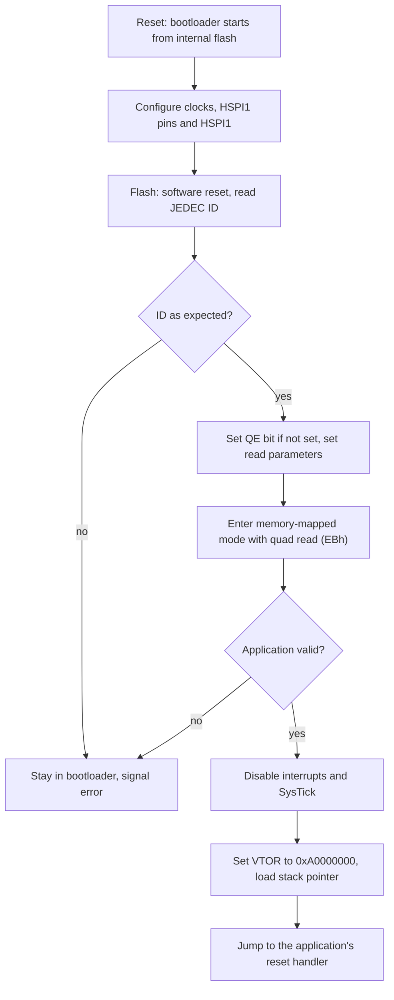
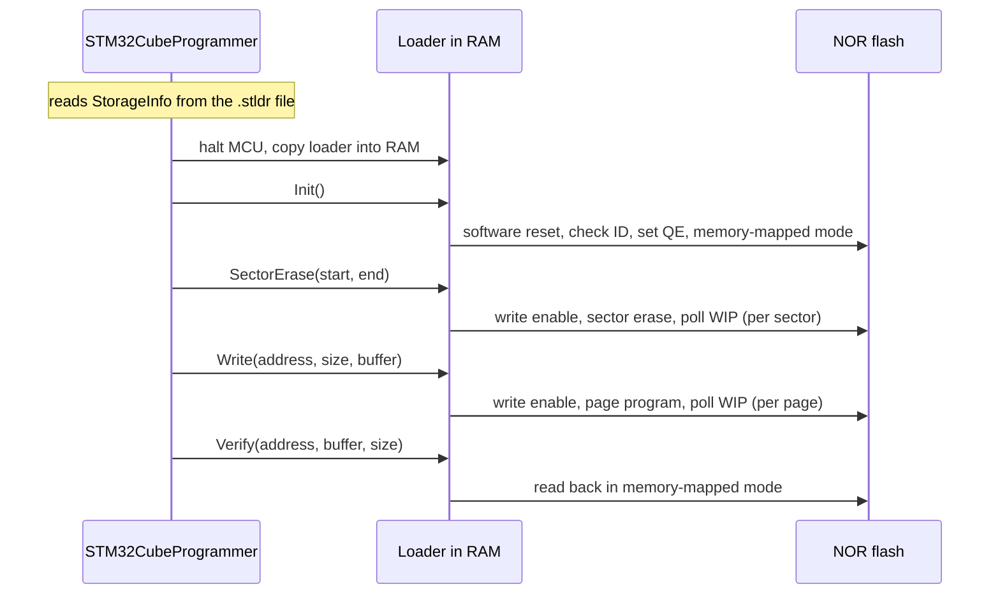

# System concept

This document describes how the application is stored in and executed from the external NOR flash, and where the external loader fits in.

## 1. Components

| Component | Stored in | Runs from | Job |
|---|---|---|---|
| Bootloader | Internal flash | Internal flash | Initialise the external flash, map it into the address space, start the application |
| External loader (this repository) | `.stldr` file on the PC | MCU RAM, only while programming | Let STM32CubeProgrammer erase, write and verify the external flash |
| Application | External flash | External flash (execute in place) | The product firmware |
| Flash driver | Part of bootloader and loader | – | Shared code for the IS25LP128F command set on top of the XSPI HAL |

The loader and the bootloader never run at the same time. Both need the same flash initialisation, which is why the flash driver is a separate layer used by both.

## 2. Architecture

Software layers inside the loader and the bootloader:

| Layer | Loader | Bootloader |
|---|---|---|
| Entry points | `Init`, `Write`, `SectorErase`, `MassErase`, `Verify`, `CheckSum` | Reset handler, `main`, jump to application |
| Flash driver | IS25LP128F driver (shared) | IS25LP128F driver (shared) |
| Board support | Clock, GPIO and HSPI1 setup | Clock, GPIO and HSPI1 setup |
| HAL | STM32U5 HAL: XSPI, RCC, GPIO | STM32U5 HAL: XSPI, RCC, GPIO |

## 3. Memory map

| Region | Start | End | Size | Content |
|---|---|---|---|---|
| Internal flash | `0x08000000` | `0x083FFFFF` | 4 MB | Bootloader |
| SRAM1 | `0x20000000` | `0x200BFFFF` | 768 KB | Loader code and data while programming (linked from `0x20000004`, see `loader/STM32U5G9ZJTx_RAM.ld`); bootloader and application data otherwise. The loader image uses only the lower ~256 KB so CubeProgrammer can keep a data buffer in the rest. |
| HSPI1 registers | `0x420D3400` | – | – | Interface control |
| External flash, memory-mapped | `0xA0000000` | `0xA0FFFFFF` | 16 MB | Application: vector table at `0xA0000000`, then code and constants |

Flash geometry as seen by the programmer: 4096 sectors of 4 KB, 256-byte pages, erased value `0xFF`.

Addresses come from the CMSIS device header `stm32u5g9xx.h`. The loader start address `0x20000004` follows ST's reference loader for the U5 family.

## 4. Boot flow

Details of the individual steps:

- **Known flash state.** The MCU can be reset without the flash being power-cycled. The schematic shows no dedicated reset line to the flash, and the shared HOLD#/RESET# pin becomes IO3 once quad mode is enabled. The bootloader therefore starts with the software reset sequence `66h` / `99h` instead of assuming power-on state.
- **Quad enable.** QE is bit 6 of the status register and is non-volatile. It has to be written once; afterwards the bootloader only checks it.
- **Read command.** Memory-mapped mode uses fast read quad I/O (`EBh`): command on one line, 3-byte address and data on four lines, 6 dummy cycles of which the first 2 carry the mode bits (mode `0x00`, not `AXh`). Details: [`doc/flash_driver_design.md`](flash_driver_design.md).
- **Application check.** The first two words of the application are the initial stack pointer and the reset vector. The bootloader accepts the image only if the stack pointer lies in RAM and the reset vector lies inside `0xA0000000`–`0xA0FFFFFF`. An erased flash reads `0xFFFFFFFF` and fails this check.
- **Hand-over.** The bootloader leaves HSPI1 running in memory-mapped mode. Everything else it used is switched off before the jump.

Rules for the application:

- It is linked to `0xA0000000` and sets its vector table address there.
- It must not reconfigure or disable HSPI1, its pins or its clock while running from the external flash. Code that has to do so must run from RAM. If you really need to do one of those things, that code must live in RAM (or in the internal flash). While it runs from RAM it can safely reconfigure HSPI, then restore memory-mapped mode before returning to code in the external flash.
- A change of the system clock must not disturb the HSPI1 clock. Either the bootloader sets the final clock tree, or HSPI1 gets its clock from a PLL output the application leaves alone.

## 5. Programming flow

How the loader works:

- **Description block.** `StorageInfo` tells the programmer the device name, base address `0xA0000000`, size, page size and sector layout. It is read from the file, not from the target.
- **Entry points instead of a program.** The programmer calls the functions one at a time through the debug probe and reads the return value (1 = success, 0 = failure). There is no reset handler and no `main`.
- **Addresses.** The programmer passes absolute addresses (`0xA0…`). The loader subtracts the base address before talking to the flash.
- **Mode switching.** `Init` ends in memory-mapped mode so the programmer can read the flash directly. `Write` and the erase functions leave memory-mapped mode, send commands, and `Verify` switches back.

Constraints that follow from running this way:

- **No startup code.** `Init` has to clear its own zero-initialised data and call the system initialisation itself.
- **No interrupts.** See [Polled time base](#polled-time-base) below.
- **Repeatable.** `Init` can be called more than once and after a previous run of the bootloader or application, so it must not depend on the state of the clocks, HSPI1 or the flash.
- **Small and self-contained.** Code and data must fit in RAM next to the programmer's data buffer; only polling HAL functions are used.

### Polled time base

The loader is not normal application firmware. CubeProgrammer copies the `.stldr` image into RAM and invokes `Init`, `Write`, erase and verify through the debug probe. There is no reset handler, no `main`, and no usable interrupt vector table for that session.

A default HAL setup that relies on **SysTick IRQ → `HAL_IncTick` → `HAL_GetTick`** therefore never runs. Without a replacement time base:

- HAL / XSPI **timeouts hang or fail** (command waits, WIP polling after program/erase)
- Long operations such as **chip erase** (tens of seconds) become unreliable
- Enabling SysTick (or any) interrupts without a proper vector table risks a **fault or lockup**

The loader therefore keeps interrupts off and replaces the HAL tick with a **polled** implementation (`loader/Src/loader_timebase.c`): SysTick runs as a free-running HCLK down-counter with `TICKINT` clear; `HAL_GetTick()` samples the counter and advances `uwTick` in software. That keeps erase/program/verify timeouts correct while the loader stays interrupt-free.

## 6. Clock concept

| | Loader | Bootloader |
|---|---|---|
| System clock | 24 MHz, HSE crystal directly, no PLL | PLL from the 24 MHz HSE |
| HSPI1 clock | 24 MHz (system clock, no prescaler) | Higher, to be fixed from the MCU and flash timing data |
| Reason | Programming time is dominated by the flash's own erase and program times, so a simple and safe clock is worth more than speed | Read speed determines how fast the application executes |

## 7. Tooling

- The `.stldr` format belongs to STM32CubeProgrammer. It works with ST-Link, and with J-Link when the probe is used through STM32CubeProgrammer.
- SEGGER's own tools (J-Flash, Ozone) use a different loader format. Supporting them means a second, thin wrapper around the same flash driver.

## 8. Assumptions and open points

- TrustZone is disabled; everything runs in the non-secure world.
- The crystal frequency of 24 MHz is an assumption.
- The MCU boots from internal flash (BOOT0 low).
- JEDEC ID is `9Dh 60h 18h`; `EBh` uses the default 6 dummy cycles (valid up to 81 MHz). See [`doc/flash_driver_design.md`](flash_driver_design.md).
- The HSPI1 clock frequency for the bootloader is not chosen yet.
- **Field update without CubeProgrammer.** The `.stldr` path is for bring-up and production programming with a debug probe. In the field, application updates must go through a product mechanism (bootloader + UART/USB/CAN/OTA) that reuses the flash driver, verifies the image, and restarts into XIP — details still undefined (transport, image layout, A/B slots, rollback).
- **Application IP protection.** External NOR is readable offline; XIP does not hide the binary. A later security design may need encrypted storage / OTFDEC, keys inside the MCU, and signed images — coordinated with the field-update path. See also [milestones open points](../project_management/milestones.md#open-points).

## References

- [STM32U5G9ZJ datasheet](https://www.st.com/resource/en/datasheet/stm32u5g9zj.pdf) (STMicroelectronics, DS14102 Rev 5)
- [IS25LP128F datasheet](https://www.issi.com/WW/pdf/25LP-WP128F.pdf) (ISSI, Rev. A10, 03/09/2026)
- [STM32 external loader examples](https://github.com/STMicroelectronics/stm32-external-loader) (STMicroelectronics), used as reference for the loader structure
- [CMSIS device header for STM32U5](https://github.com/STMicroelectronics/cmsis_device_u5) (STMicroelectronics), source of the memory addresses

